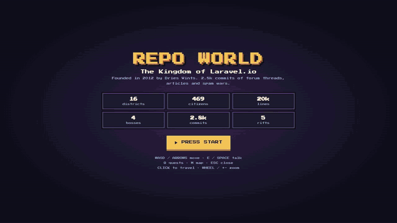

# 🏙️ Repo World

**Turn any codebase into a pixel-art RPG city. Walk around it. Talk to your classes. Slay your god objects.**

An [Agent Skill](https://docs.claude.com/en/docs/agents-and-tools/agent-skills/overview) for Claude (and any `SKILL.md`-compatible agent). Point it at a repo, get back one HTML file you can play in the browser, on desktop or phone.



**▶ [Play the laravel.io world in your browser](https://<you>.github.io/repo-world/)** (no install, works on phone)

```
> /repo-world turn this repo into a game
✓ laravel.io (Laravel): 469 files, 19,895 LOC, 16 districts, 779 imports, 4 bosses, 5 cycles, 24 graves
✓ repo-world.html (202 KB) with lore
```

## What you get

| Your code | Your world |
|---|---|
| Folders | Fenced districts with signs |
| Files | Houses, roof color by role (controller, model, service, component…) |
| Classes / components | NPCs who tell you what they do, what they depend on and who uses them |
| God classes (450+ LOC or 30+ methods) | 👾 Bosses guarding dark towers |
| Most-edited files | 🔥 Houses on fire |
| Imports between folders | Roads on the world map |
| Circular dependencies | 🌀 Portals in **The Rift** |
| Deleted files | 🪦 Tombstones with author, date and the commit message that killed them |
| Top contributors | 🗿 Statues in the **Hall of Heroes** |

Plus a **quest log** that teaches the codebase ("Follow a request from the route to the database", "Find who sends the welcome email"), XP, levels, a fast-travel map and a quest compass.

## Why

Onboarding docs go stale and nobody reads architecture diagrams. Walking into the "Archives", finding a 448-line `User` model imported by 119 files and hearing it say *"Some say I've grown too big"* sticks.

Good for: onboarding new devs · understanding a repo you inherited · tech-debt talks your manager will actually watch · showing off your side project.

## Install

**Claude Code**
```bash
git clone https://github.com/<you>/repo-world ~/.claude/skills/repo-world
```

**Claude.ai / desktop**: zip the folder → Settings → Capabilities → Skills → Upload.

Then ask: *"turn this repo into a repo world"*.

## How it works

```
repo ──scan.py──▶ world.json ──Claude reads the code, writes lore.json──▶ build.py ──▶ repo-world.html
```

1. **`scripts/scan.py`**: deterministic, zero dependencies (Python 3.9+). Parses files, classes, methods, imports (PHP `use`, JS/TS imports + `@/` aliases, Python), finds import cycles (Tarjan SCC), god classes, and reads git history for churn, deleted files and contributors.
2. **Lore**: Claude opens the important files and writes NPC dialogue, district names and quests grounded in what the code really does.
3. **`scripts/build.py`**: bakes everything into `assets/template.html`, a single-file canvas game. No framework, no build step.

Manual run, no AI (auto-generated dialogue and quests):
```bash
python3 scripts/scan.py path/to/repo -o world.json
python3 scripts/build.py world.json -o repo-world.html
```

## Stacks

Laravel · Angular · React / Next · Vue / Nuxt · Svelte · NestJS / Express · Django / Python · Go · Java / Kotlin / C# · Ruby

## Controls

`WASD`/arrows move · `E`/`Space` talk · `Q` quests · `M` map · `Esc` close

**Click to fast-travel**: click any NPC, boss, grave or portal to jump next to it and start talking, click the ground to teleport there, or click anywhere on the world map.

**Zoom**: mouse wheel, `+` / `-` (`0` resets), pinch on phones. Touch D-pad on mobile.

## Privacy

Everything runs locally. The scanner reads code structure and git metadata only. The HTML contains file paths, class/method names, contributor names and deleted-file commit messages, so review it before publishing a private repo's world.

## License

MIT
